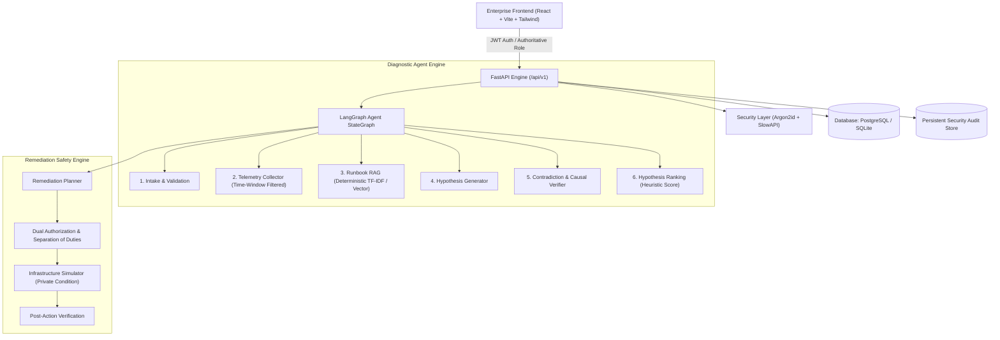

# IncidentIQ

> **Autonomous SRE Incident Diagnosis & Remediation Platform**  
> *Evidence first, AI second, remediation only with authorization.*

[](https://github.com/example/incidentiq/actions)
[](https://www.python.org/)
[](https://fastapi.tiangolo.com)
[](https://react.dev)
[](https://www.typescriptlang.org/)
[](https://opensource.org/licenses/MIT)

---

## 1. System Architecture



---

## 2. Invariants & Operational Boundaries

1. **Sacred Ground-Truth Isolation**: The scenario generator is the sole module that knows ground truth. Observables reach the diagnosis layer cleanly without hidden labels, expected actions, or hints.
2. **Post-Hoc Evaluation**: Predictions are finalized strictly before the evaluator accesses ground truth.
3. **Deterministic Zero-Key Operation**: The entire platform functions out of the box without any paid API keys or external cloud dependencies.
4. **All Telemetry is Synthetic**: Generated from deterministic seeded random templates with real-world noise.
5. **All Remediation is Simulated**: Infrastructure actions (scaling, restarts, rollbacks, cache flushes) execute against state machines; real host systems are never touched.
6. **Heuristic Confidence**: Scores represent evidence coverage percentages, never calibrated Bayesian probabilities.

---

## 3. Technology Stack

- **Backend**: Python 3.11+, FastAPI, SQLAlchemy 2, Alembic, Pydantic V2, Pydantic-Settings, PyJWT, Argon2-cffi, SlowAPI, LangGraph.
- **Frontend**: React 19, TypeScript, Vite, Tailwind CSS v4, TanStack Query, Recharts, Lucide Icons, React Router v7.
- **Database & Storage**: PostgreSQL 16 + pgvector (Production) / SQLite with in-process vector fallback (Local/Test).
- **Tooling & Quality**: Pytest (40 tests), Ruff linter, Oxlint, TypeScript strict mode.

---

## 4. Quickstart Guide

### Option A: Local Development (SQLite)

#### 1. Setup Backend:
```bash
# In project root
python -m venv venv
# Windows: venv\Scripts\activate | Unix: source venv/bin/activate
pip install -r backend/requirements.txt

# Run migrations and seed deterministic data
cd backend
alembic upgrade head
python -m incidentiq.seed
cd ..

# Start backend server
uvicorn incidentiq.api:app --host 0.0.0.0 --port 8000 --reload
```

#### 2. Setup Frontend:
```bash
cd frontend
npm install
npm run dev
```
Open [http://localhost:5173](http://localhost:5173).

---

### Option B: Docker Compose (PostgreSQL + pgvector)

```bash
cp .env.example .env
docker compose up --build
```
Access points:
- **Frontend Web Portal**: [http://localhost](http://localhost) (Port 80)
- **Backend REST API**: [http://localhost:8000](http://localhost:8000)
- **Interactive Swagger Docs**: [http://localhost:8000/docs](http://localhost:8000/docs)

---

## 5. Pre-Seeded Demo Accounts (Development Only)

All pre-seeded demo accounts use password: `demo-only`.

| Username | Authoritative Role | Permissions |
|---|---|---|
| `demo-viewer` | `viewer` | Read-only inspection of incidents, telemetry, and service map |
| `demo-engineer` | `engineer` | Declare incidents, trigger AI diagnosis, execute approved remediations |
| `demo-incident_commander` | `incident_commander` | Dual-authorization approvals, declare incidents, execute remediations |
| `demo-admin` | `admin` | Full system access, benchmark evaluation runner, runbook re-indexing |
| `demo-disabled` | `admin` (inactive) | Inactive user account (verifies 403 enforcement) |

> [!WARNING]
> In production (`INCIDENTIQ_ENV=production`), demo accounts are automatically disabled and `INCIDENTIQ_JWT_SECRET` (>= 32 characters) is strictly enforced at startup.

---

## 6. Benchmark Evaluation & Measured Results

The evaluation runner compares deterministic rules against a naive keyword baseline across 8 scenarios and 3 seeds ($N=24$ total trials).

Run evaluation CLI:
```bash
python -m incidentiq.evaluation
```

### Real Measured Benchmark Results ($N=24$):

| Metric | Deterministic Rules Engine | Naive Keyword Baseline |
|---|:---:|:---:|
| **Top-1 Diagnostic Accuracy** | **100.0%** (24/24) | **87.5%** (21/24) |
| **Top-k Diagnostic Recall ($k=3$)** | **100.0%** (24/24) | **87.5%** (21/24) |
| **Evidence Precision** | **64.6%** | N/A |
| **Evidence Recall** | **62.5%** | N/A |
| **Unsupported Claim Rate** | **0.0%** | N/A |
| **Remediation Action Accuracy** | **100.0%** | N/A |
| **Post-Action Verification Recovery** | **100.0%** | N/A |
| **Mean Execution Latency** | **~0.17 ms** | ~0.08 ms |

*Note: Naive regex keyword baseline fails on scenarios with misleading decoy logs (`cpu_saturation` and `network_timeout`), whereas deterministic diagnosis corroborates signals across metrics and causal ordering.*

---

## 7. Directory Layout

```
incidentiq-core/
├── backend/
│   ├── alembic/              # Database migration version scripts
│   ├── incidentiq/
│   │   ├── agent.py          # LangGraph state machine & LLM integration
│   │   ├── api.py            # FastAPI REST endpoints
│   │   ├── audit.py          # Persistent security audit logger
│   │   ├── config.py         # Typed settings (pydantic-settings)
│   │   ├── database.py       # SQLAlchemy engine & session management
│   │   ├── diagnosis.py      # Blind rule diagnosis & signature matching
│   │   ├── evaluation.py     # Post-hoc benchmark runner
│   │   ├── knowledge.py      # Runbook RAG & TF-IDF/vector search
│   │   ├── logging.py        # Structured JSON logger with redaction
│   │   ├── models.py         # 14 SQLAlchemy 2 database tables
│   │   ├── remediation.py    # Simulated remediation engine & Simulator
│   │   ├── scenarios.py      # SYNTHETIC scenario generator (Ground Truth)
│   │   ├── security.py       # Argon2 password hashing & RBAC
│   │   └── seed.py           # Idempotent deterministic seeding
│   ├── tests/                # 40 comprehensive test cases
│   ├── Dockerfile
│   └── requirements.txt
├── frontend/
│   ├── src/
│   │   ├── api/client.ts     # Typed API client
│   │   ├── components/       # Layout, StatusBadge
│   │   ├── context/          # AuthContext
│   │   └── pages/            # 9 SRE Dashboard pages
│   ├── Dockerfile
│   ├── nginx.conf
│   └── package.json
├── data/
│   └── runbooks/             # 9 Markdown operational runbooks
├── docs/
│   ├── architecture.md       # Architecture & state machine design
│   ├── api.md                # Full REST API specification
│   ├── evaluation.md         # Benchmark formulas & measured results
│   ├── security.md           # Threat model & RBAC matrix
│   ├── demo-guide.md         # Step-by-step user walkthrough
│   └── status.md             # Phase completion tracker
├── docker-compose.yml
├── .env.example
└── README.md
```
# IncidentIQ

