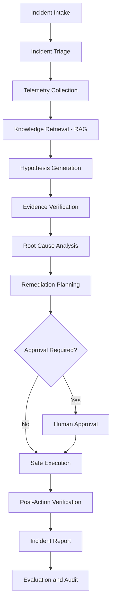

# IncidentIQ
### Agentic AI Incident Response, Root-Cause Analysis & Intelligent Remediation Platform

IncidentIQ is an AI-powered incident management and investigation platform designed to help engineering teams understand system failures, identify potential root causes, retrieve relevant technical knowledge, and recommend safe remediation strategies.

It combines **Agentic AI, Retrieval-Augmented Generation (RAG), LangGraph, telemetry analysis, and automated investigation workflows** to transform traditional incident response into a structured, evidence-driven process.

---

## Overview

Modern distributed applications generate large volumes of logs, metrics, deployment events, and operational data. Identifying the actual cause of an incident across these sources can be time-consuming and requires significant manual investigation.

IncidentIQ addresses this challenge through an intelligent investigation workflow that:

- Analyzes incident descriptions and severity.
- Collects and examines relevant telemetry.
- Retrieves supporting technical documentation using RAG.
- Generates and ranks root-cause hypotheses.
- Evaluates supporting and contradictory evidence.
- Recommends context-aware remediation actions.
- Supports human approval for sensitive operations.
- Verifies simulated remediation outcomes.
- Generates structured incident investigation reports.

The goal is to make incident response faster, more explainable, and more consistent.

## Key Features

### 1. Intelligent Incident Triage
- Incident intake and classification.
- Severity assessment.
- Service-level context.
- Structured investigation initiation.

### 2. Telemetry Analysis
- Log and metric analysis.
- Detection of abnormal system behavior.
- Investigation time-window filtering.
- Deployment-event correlation.
- Synthetic incident scenarios for testing.

### 3. AI-Powered Root-Cause Analysis
- Hypothesis generation.
- Root-cause ranking.
- Evidence-based verification.
- Supporting and contradictory evidence.
- Confidence and uncertainty assessment.

### 4. Retrieval-Augmented Generation (RAG)
- Technical knowledge retrieval.
- Document-based context enrichment.
- Semantic search using embeddings.
- Source-aware knowledge references.
- Context-grounded investigation support.

### 5. Agentic Investigation Workflow
Built around LangGraph, the investigation pipeline organizes tasks into specialized stages.

The workflow can coordinate telemetry analysis, knowledge retrieval, hypothesis generation, verification, remediation planning, and report generation.

### 6. Intelligent Remediation
- Context-aware remediation recommendations.
- Action allowlisting.
- Risk assessment.
- Human approval workflow.
- Simulated remediation execution.
- Post-action verification.

**Safety note:** Demonstration remediation actions are simulated. Real infrastructure changes require separately configured and authorized integrations.

### 7. Evaluation and Observability
- Investigation execution tracking.
- Evidence quality measurements.
- Root-cause evaluation.
- Remediation evaluation.
- Investigation history.
- Audit records.

---

## System Architecture



### High-Level Components

| Component | Responsibility |
|---|---|
| Frontend | Incident management and investigation visualization |
| FastAPI Backend | API endpoints and application services |
| LangGraph | Investigation workflow orchestration |
| Telemetry Engine | Log and metric collection and analysis |
| Knowledge Engine | Document ingestion and retrieval |
| RCA Engine | Hypothesis generation and verification |
| Remediation Engine | Action validation and execution simulation |
| Evaluation Engine | Investigation quality measurement |
| Database | Incident, investigation, telemetry, and audit persistence |

---

## Technology Stack

| Category | Technologies |
|---|---|
| Backend | Python, FastAPI |
| AI Orchestration | LangGraph |
| AI / LLM Integration | OpenAI API |
| RAG | Embeddings, Semantic Retrieval |
| Frontend | React, TypeScript, Vite |
| Database | SQLAlchemy, SQLite / PostgreSQL |
| Vector Search | Embedding-based retrieval; pgvector where configured |
| Caching | Redis (optional) |
| Authentication | JWT, Role-Based Access Control |
| Password Security | Argon2 |
| API Documentation | FastAPI / Swagger |
| Testing | Pytest |
| Deployment | Docker |

---

## Investigation Workflow

An investigation follows a structured sequence:

**1. Incident Intake**

The system receives an incident description, affected service, and severity.

**2. Telemetry Collection**

Relevant logs, metrics, and deployment information are collected for the investigation period.

**3. Knowledge Retrieval**

The knowledge engine searches relevant technical documentation and retrieves contextual information.

**4. Hypothesis Generation**

Potential root causes are generated using available observations and retrieved knowledge.

**5. Evidence Verification**

Each hypothesis is evaluated against relevant supporting and contradictory evidence.

**6. Root-Cause Analysis**

The system ranks potential explanations and communicates uncertainty or missing evidence.

**7. Remediation Planning**

The system recommends an appropriate action based on the identified issue and its risk.

**8. Approval and Execution**

Actions requiring authorization go through an approval process before simulated execution.

**9. Verification and Reporting**

The system checks the outcome and generates an investigation report containing findings, evidence, and remaining risks.

---

## Security and Reliability

IncidentIQ incorporates security and operational safeguards, including:

- JWT-based authentication.
- Role-Based Access Control (RBAC).
- Argon2 password hashing.
- Server-side remediation validation.
- Approval-based execution controls.
- Audit-event tracking.
- Environment-based configuration.
- Structured application logging.

Production deployment requires environment-specific security configuration and validation of all external integrations.

---

## Project Structure

The repository is organized into frontend and backend components.

```text
IncidentIQ/
│
├── backend/
│   ├── app/
│   │   ├── api/
│   │   ├── core/
│   │   ├── models/
│   │   ├── schemas/
│   │   ├── services/
│   │   └── main.py
│   │
│   ├── tests/
│   ├── requirements.txt
│   └── ...
│
├── frontend/
│   ├── src/
│   ├── public/
│   ├── package.json
│   └── ...
│
├── docker-compose.yml
├── README.md
└── ...
```

*Directory names may vary depending on the current implementation.*

---

## Getting Started

### Prerequisites

Install the following:

- Python 3.11 or compatible project version.
- Node.js and npm.
- Git.
- An optional OpenAI API key for LLM-powered functionality.
- Docker, if using containerized deployment.

### 1. Clone the Repository

```bash
git clone <YOUR_GITHUB_REPOSITORY_URL>
cd IncidentIQ
```

### 2. Backend Setup

```bash
cd backend
python -m venv .venv
```

Activate the virtual environment.

**Windows PowerShell:**

```powershell
.venv\Scripts\Activate.ps1
```

Install dependencies:

```bash
pip install -r requirements.txt
```

### 3. Environment Configuration

Create a `.env` file using the configuration supported by your backend.

Example configuration:

```env
DEBUG=false
DEMO_MODE=true

OPENAI_API_KEY=your_openai_api_key
OPENAI_MODEL=gpt-4o-mini

JWT_SECRET_KEY=replace_with_a_secure_random_secret

DATABASE_URL=sqlite+aiosqlite:///./incidentiq.db
```

Configure optional services such as PostgreSQL, Redis, and vector search only when enabled in the application.

**Never commit your actual `.env` file or API keys to GitHub.**

### 4. Start the Backend

Use the application entry point configured in the backend.

For the standard FastAPI entry point:

```bash
uvicorn app.main:app --reload
```

Backend API:

```text
http://127.0.0.1:8000
```

Swagger API documentation:

```text
http://127.0.0.1:8000/docs
```

Health endpoint:

```text
http://127.0.0.1:8000/health
```

### 5. Frontend Setup

Open a separate terminal:

```bash
cd frontend
npm install
npm run dev
```

Open the local development URL printed by Vite.

### 6. Run Tests

From the backend directory:

```bash
pytest -v
```

Run the frontend build:

```bash
npm run build
```

---

## Evaluation

IncidentIQ is designed to evaluate incident investigation quality through measurable criteria:

| Metric | Purpose |
|---|---|
| Top-1 Root-Cause Accuracy | Measures whether the highest-ranked diagnosis is correct |
| Top-K Accuracy | Measures whether the correct diagnosis appears among the leading hypotheses |
| Evidence Precision | Measures the relevance of selected supporting evidence |
| Evidence Recall | Measures how much relevant evidence was retrieved |
| Unsupported Claim Rate | Measures conclusions lacking sufficient evidence |
| Remediation Accuracy | Measures whether the recommended action matches the scenario |
| Verification Success Rate | Measures successful post-action verification |
| Investigation Latency | Measures investigation execution time |

Benchmark ground truth should remain isolated from the diagnostic workflow and be used only by the evaluation system.

Actual benchmark results should be reported only after executing the evaluation suite.

---

## Future Enhancements

- Distributed tracing integration.
- OpenTelemetry support.
- Prometheus and Grafana integration.
- Advanced anomaly detection.
- Multi-agent investigation coordination.
- Improved causal dependency analysis.
- Production-grade vector database integration.
- Kubernetes incident response integration.
- Real infrastructure remediation adapters with strict authorization.
- Advanced benchmark datasets and evaluation.

---

## Engineering Goals

IncidentIQ explores the intersection of:

- Agentic AI
- Site Reliability Engineering (SRE)
- Retrieval-Augmented Generation
- Explainable AI
- Automated Root-Cause Analysis
- Intelligent Incident Management
- Secure Automated Remediation

The central objective is to build an intelligent incident response platform that does not simply generate explanations, but connects its findings to observable evidence and communicates uncertainty clearly.

---

## Author

**Naitik Sharma**

B.Tech – Computer Science and Engineering

Areas of Interest: AI Engineering, Agentic AI, Generative AI, RAG, Backend Development, and Intelligent Automation.

---

## License

Add an appropriate open-source license before distributing the project publicly.
