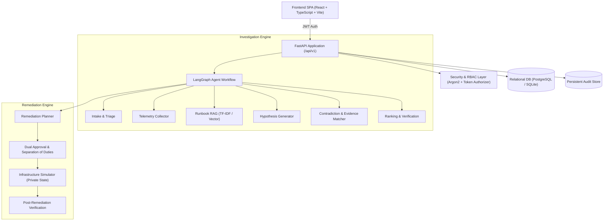
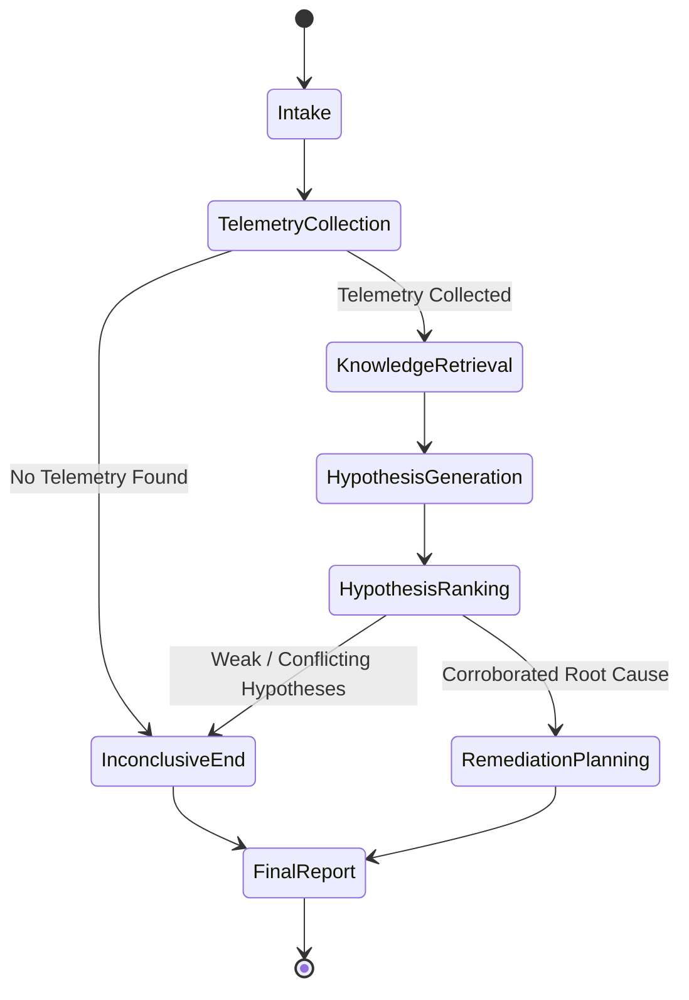

# IncidentIQ Architecture & System Design

## 1. High-Level Architecture Overview

IncidentIQ is an autonomous SRE incident diagnosis and simulated remediation platform designed around the core principle:
**Evidence first, AI second, remediation only with authorization.**

---

## 2. Component Isolation & Sacred Ground-Truth Boundary

A fundamental invariant of IncidentIQ is strict **ground-truth isolation**:

1. **Scenario Generator (`scenarios.py`)**: The only module that knows ground truth. Emits `(observables, GroundTruth)`.
2. **Diagnosis & Agent Layer (`diagnosis.py`, `agent.py`)**: Completely blind. Accepts only `observables`. Banned from referencing, importing, or querying ground truth in state, prompts, tool outputs, or DB tables.
3. **Infrastructure Simulator (`remediation.py`)**: Encapsulates true condition in memory (`_cause`). Never exposes it to the agent. Receives applied actions and reports post-action recovery.
4. **Post-Hoc Evaluator (`evaluation.py`)**: Evaluates predictions strictly **after** they are generated.

---

## 3. LangGraph Agent Workflow

---

## 4. Database Schema (SQLAlchemy 2 Models)

The persistence layer defines 14 tables managed via Alembic migrations:
- `users`: User credentials (Argon2 hashed), active flag, authoritative role.
- `services`: Monitored service metadata, tiers, and dependency lists.
- `incidents`: Incident records, status transitions, timestamps.
- `telemetry_records`: Observables (logs, metrics, deployments) linked to incidents.
- `investigations`: Investigation metadata, execution duration, root cause findings.
- `evidence`: Stable evidence records (`ev:...`) linked to investigations.
- `hypotheses`: Evaluated hypotheses with supporting and contradicting evidence IDs.
- `remediation_actions`: Proposed infrastructure actions, parameters, risk, and payload hash.
- `approvals`: Dual-authorization records linking exact action ID and payload hash.
- `audit_events`: Immutable security audit logs (distinct from application logs).
- `knowledge_documents`: Runbooks and architecture documentation.
- `knowledge_chunks`: Chunked documentation with embedding vectors.
- `evaluation_runs`: Post-hoc benchmark execution runs.
- `evaluation_results`: Per-scenario benchmark trial records.

